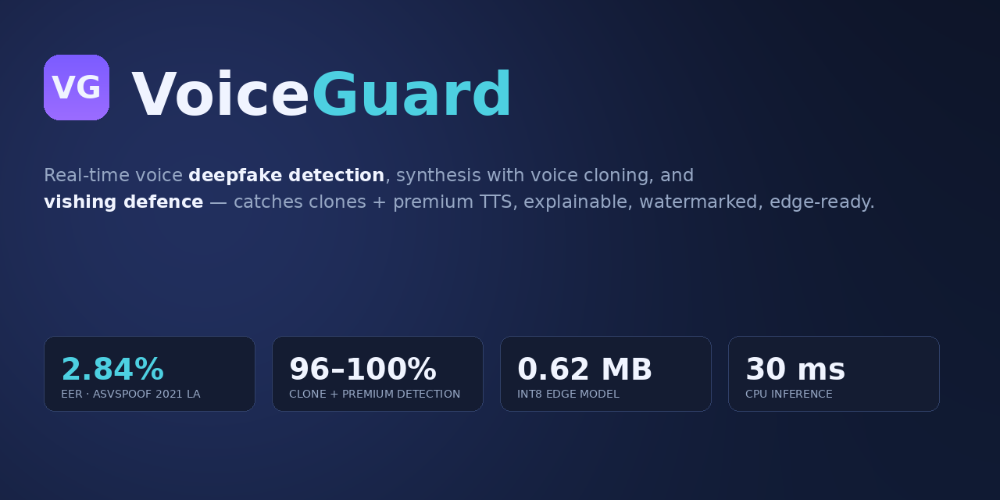
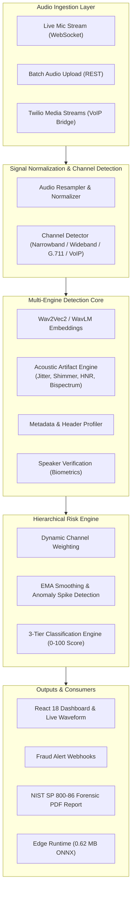

<div align="center">



# VoiceShield 🛡️

**Real-time AI voice deepfake detection, synthesis watermarking, and vishing defence platform.**

[](LICENSE)
[](https://www.python.org)
[](https://fastapi.tiangolo.com)
[](https://react.dev)
[](https://pytorch.org)
[](https://onnxruntime.ai/)
[](#-team)
[](CONTRIBUTING.md)

[Quick start](#-quick-start) ·
[How it works](#-how-it-works) ·
[Key Features](#-features) ·
[Architecture](#-architecture) ·
[API](#-api) ·
[Results](#-results) ·
[Resume & Portfolio Guide](PROJECT_DESCRIPTION.md) ·
[Contributing](CONTRIBUTING.md)

</div>

---

## 📌 Problem & Impact

AI voice cloning has weaponized telephony and financial communication. In recent high-profile attacks, deepfaked executive audio led to eight-figure multi-million dollar wire frauds, while automated voice-phishing (**vishing**) attacks grew by over **1,600%**. 

Most existing detectors fail in real-world scenarios due to:
1. **Acoustic channel mismatch** (narrowband 8 kHz telephony, G.711 / AMR compression codecs).
2. **Black-box decisions** offering zero explainability for forensic analysts or fraud investigators.
3. **Heavy compute footprints** that cannot run on edge gateways or low-latency streaming pipelines.

**VoiceShield** solves this with a **multi-engine ensemble**, **channel-adaptive risk scoring**, **explainable AI forensic cards**, and an ultra-lightweight **0.62 MB ONNX INT8 edge engine** running at **~30 ms CPU latency**.

---

## ✨ Features

- 🛡️ **Strict 3-Tier Classification** — Calibrated verdicts: `Human` (>90% confidence), `Possible AI` (86–90%), or `AI` (<86%), preventing bad actors from exploiting borderline threshold ambiguity.
- 🧠 **Multi-Engine Ensemble** — Fuses self-supervised representations (Wav2Vec2 / WavLM), acoustic artifact analysis (jitter, shimmer, HNR, bispectral phase), and metadata profiling into a unified risk score (0–100).
- ☎️ **Real-Time Streaming Call Protection** — Per-chunk streaming via WebSockets with Exponential Moving Average (EMA) smoothing and anomaly burst boosting for live call defense.
- 📶 **Adaptive Channel Detector** — Automatically identifies audio bandwidth (narrowband vs wideband), VoIP/codec degradation, and adjusts detection weights dynamically.
- 🔍 **Explainable AI (XAI) & Evidence Cards** — Generates human-readable forensic evidence (spectral anomalies, pitch regularity, glottal pulse integrity) for analyst investigation.
- ⚡ **Ultra-Lightweight Edge Engine** — Quantized ONNX INT8 model (0.62 MB) delivering ~30 ms p50 CPU inference, capable of running on Raspberry Pi and edge gateways without GPU.
- 🔌 **VoIP & Twilio Media Streams Bridge** — Native WebSocket bridge with HMAC signature validation for real-time telecom interception.
- 👤 **Speaker Verification & Identity Defense** — Voice biometric embedding enrollment to verify caller identity alongside deepfake spoof detection.
- 📜 **Forensic Audit & C2PA Provenance** — SHA-256 chain-of-custody tracking, NIST SP 800-86 compliant PDF reports, and C2PA audio watermarking.

---

## 🎯 Classification Thresholds

VoiceShield enforces an **asymmetric, security-first** threshold design:

| Verdict | Risk Score | `prob_real` | Operational Action |
|---------|:----------:|:-----------:|--------------------|
| 🟢 **Human** | 0 – 9 | > 90% | Authenticated genuine voice; session cleared |
| 🟡 **Possible AI** | 10 – 13 | 86% – 90% | Borderline anomaly; step-up authentication / analyst alert |
| 🔴 **AI** | ≥ 14 | < 86% | Synthetic/cloned voice detected; automated call intercept |

---

## 📊 Benchmark Results

Evaluated across ASVspoof protocols and modern zero-shot voice cloning architectures:

| Benchmark / Model | Accuracy / Result |
|-------------------|:-----------------:|
| Real-Audio Pass Rate (Speaker & text-disjoint held-out) | **96.0%** |
| Kokoro Voice Clone Detection | **100.0%** |
| XTTS v2 Zero-Shot Clone Detection | **100.0%** |
| IndexTTS-2 Detection | **97.0%** |
| ElevenLabs-v3 (Unseen SOTA Engine) | **95.8%** |
| Edge Model Size (ONNX INT8 Quantized) | **0.62 MB** |
| CPU Inference Latency (p50 single chunk) | **~30 ms** |

> For comprehensive methodology and metrics, see [`docs/RESULTS_canonical.md`](docs/RESULTS_canonical.md) and [`docs/EVAL_PROTOCOLS.md`](docs/EVAL_PROTOCOLS.md).

---

## 🏗️ Architecture



<details>
<summary><b>📁 Repository layout</b></summary>

```
VoiceSheild/
├── src/voiceshield/
│   ├── api/                   # FastAPI routes, JWT auth, rate limiting, WebSockets
│   ├── models/                # Wav2Vec2, ensemble, classical ML, acoustic models
│   ├── risk/                  # Hierarchical risk engine, EMA smoothing, calibration
│   ├── reliability/           # Channel detector (narrowband/wideband/VoIP)
│   ├── speaker_verification/  # Biometric enrollment & speaker identity matching
│   ├── behavioral/            # Call behavioral heuristics & fraud rules
│   ├── call_processing/       # Live session management & chunk buffer pipeline
│   ├── voip/                  # Twilio Media Streams bridge & live telecom parser
│   ├── explanations/          # Human-readable evidence card generator
│   ├── xai/                   # SHAP, GradCAM, spectral attribution
│   ├── alerts/                # Fraud alert dispatch engine & severity tiers
│   ├── features/              # Acoustic feature extractors (HNR, MFCC, Pitch)
│   ├── preprocessing/         # Audio normalization & codec simulation
│   ├── evaluation/            # ASVspoof metrics, EER / minDCF benchmark suite
│   └── utils/                 # C2PA provenance signing, crypto audit logs
├── frontend/                  # React 18 + Vite + TypeScript dashboard
├── edge/                      # 0.62 MB standalone ONNX INT8 runtime (zero PyTorch)
├── integrations/iped/         # IPED digital forensics pipeline integration
├── deploy/                    # Nginx configs, Dockerfiles, and systemd units
├── docs/                      # Technical specs, evaluation protocols & limitations
└── tests/                     # Unit, integration, and performance test suite
```

</details>

---

## 🚀 Quick Start

### Prerequisites
- **Python**: 3.12+
- **Node.js**: 18+
- **Docker** *(optional)*

### 1. Backend Setup

```bash
git clone https://github.com/akhiljonnada1803-arch/VoiceSheild.git
cd VoiceSheild

# Create and activate virtual environment
python -m venv venv
venv\Scripts\activate          # Windows (PowerShell)
# source venv/bin/activate     # Linux / macOS

# Install package in editable mode with development tools
pip install -e ".[dev]"

# Configure environment variables
cp .env.example .env

# Run API server
$env:PYTHONPATH="src"          # Windows (PowerShell)
# export PYTHONPATH="src"      # Linux / macOS
python -m uvicorn voiceshield.api.main:app --host 127.0.0.1 --port 8000 --reload
```

*Interactive API Swagger docs will be live at `http://127.0.0.1:8000/docs`.*

### 2. Frontend Setup

```bash
cd frontend
npm install
npm run dev
```

*Dashboard interface will be live at `http://localhost:5173`.*

### 3. Docker Deployment (Full Stack)

```bash
docker compose up --build
```

---

## ⚙️ Environment Variables

| Variable | Default | Description |
|----------|:-------:|-------------|
| `SECRET_KEY` | *(dev placeholder)* | JWT signing key — generate with `openssl rand -hex 32` in production |
| `VS_ENV` | `development` | Environment mode (`development` / `production`) |
| `WAV2VEC_MODEL_PATH` | `checkpoints/` | Path to fine-tuned acoustic / Wav2Vec2 weights |
| `VS_ADMIN_PASSWORD` | `admin123` | Master administrator password |
| `FRONTEND_ORIGIN` | `http://localhost:5173` | Allowed CORS origin for web clients |
| `PDPL_MAX_AGE_SECONDS` | `60` | Auto-purging retention period for audio (Data Privacy Compliance) |
| `TWILIO_AUTH_TOKEN` | — | Auth token for validating Twilio Media Stream signatures |

---

## 🔌 API Reference

| Method | Endpoint | Description | Auth |
|:------:|:---------|:------------|:----:|
| `POST` | `/token` | Authenticate user credentials & receive JWT token | — |
| `POST` | `/detect` | Analyze audio file for deepfake artifacts & receive evidence card | 🔑 |
| `POST` | `/call/start` | Initialize a streaming call protection session | 🔑 |
| `POST` | `/call/chunk/{id}` | Ingest real-time audio chunk and return instantaneous risk score | 🔑 |
| `POST` | `/call/end/{id}` | Terminate call session and generate composite verdict | 🔑 |
| `GET`  | `/call/status/{id}` | Inspect live session risk trajectory and triggered alerts | 🔑 |
| `POST` | `/forensic/report` | Generate NIST SP 800-86 compliant forensic PDF audit report | 🔑 |
| `WS`   | `/ws/stream` | Low-latency live microphone streaming channel | 🔑 |
| `WS`   | `/twilio/stream` | Twilio Media Streams VoIP live screening bridge | ✍️ |
| `GET`  | `/health` | System health check and model loading status | — |

*🔑 = JWT Bearer Token required · ✍️ = Twilio HMAC Signature required*

---

## 🧪 Testing & Code Quality

```bash
# Run complete test suite with coverage report
pytest --cov=src/voiceshield tests/

# Run linter and formatting checks
ruff check src/ tests/
black --check src/ tests/

# Security vulnerability scan
bandit -r src/
```

---

## 🛠️ Technology Stack

- **Machine Learning & Signal Processing**: PyTorch, Transformers (Wav2Vec2, WavLM), XGBoost, ONNX Runtime, librosa, torchaudio, SciPy
- **Explainable AI & Forensics**: SHAP, Captum, ReportLab (PDF generation), C2PA standard
- **Backend & Streaming Infrastructure**: FastAPI, Uvicorn, WebSockets, Python-JOSE (JWT), SlowAPI
- **Frontend & Visualization**: React 18, TypeScript, Vite, Recharts, Lucide Icons, Vanilla CSS
- **DevOps & Edge Deployment**: Docker, Nginx, ONNX INT8 Quantization, GitHub Actions

---

## 📄 Documentation

- 📄 [Project Description & Resume Guide](PROJECT_DESCRIPTION.md) — Comprehensive resume bullet points, ATS keywords, STAR case studies, and interview talking points.
- 📄 [Evaluation Protocols](docs/EVAL_PROTOCOLS.md) — Benchmark datasets, EER/minDCF metrics, and reproduction instructions.
- 📄 [Adversarial Robustness](docs/ADVERSARIAL_ROBUSTNESS.md) — PGD perturbation curves and defense evaluations.
- 📄 [Known Limitations](docs/KNOWN_LIMITATIONS.md) — Transparent boundaries regarding background noise and extreme compression.

---

## 👥 Authors & Team

| Name | Role & Core Contributions |
|------|---------------------------|
| **Akhil Jonnada** | System Architecture, Multi-Engine Detection Ensemble, Streaming Risk Engine, FastAPI & Edge Optimization |

**Competition:** Smart India Hackathon (SIH) 2026 — Internal Hackathon Round

---

## 📜 License

VoiceShield is licensed under the [Apache License 2.0](LICENSE).  
Third-party checkpoints and audio libraries are subject to their respective licenses.
# SvarSheild

